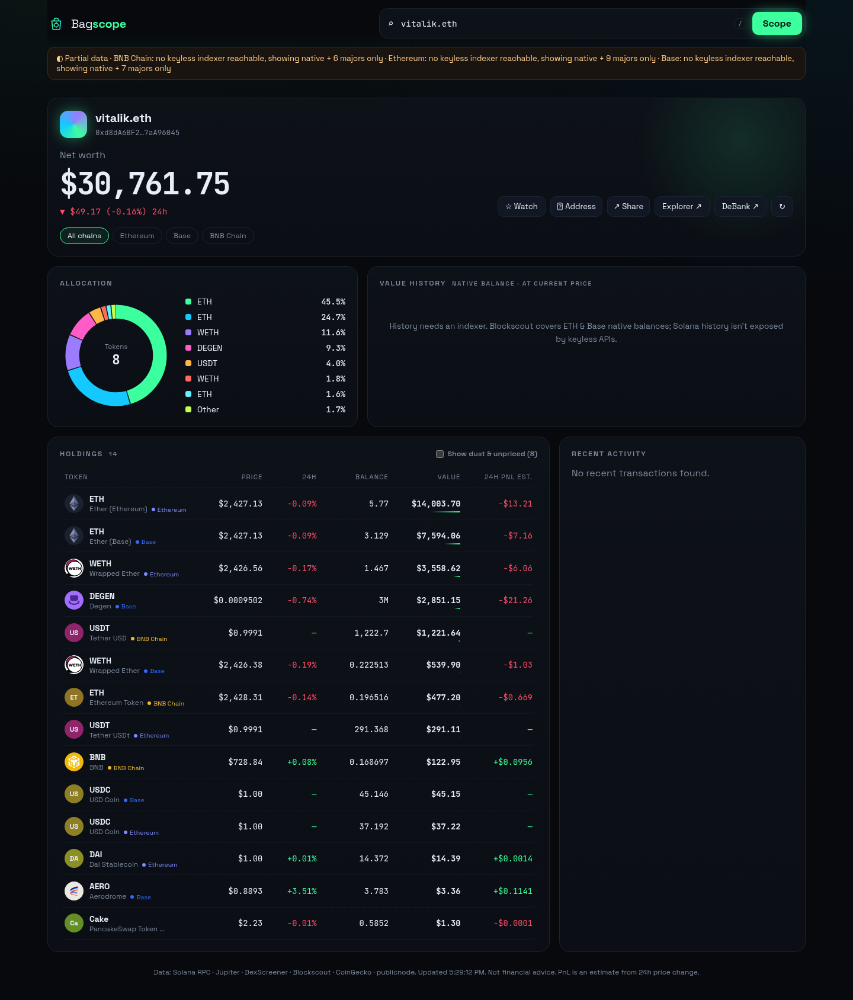
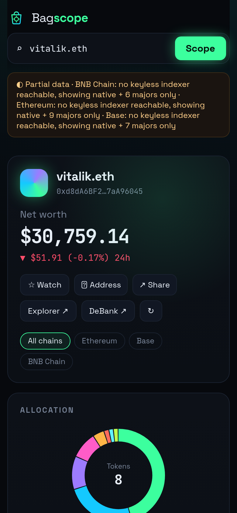
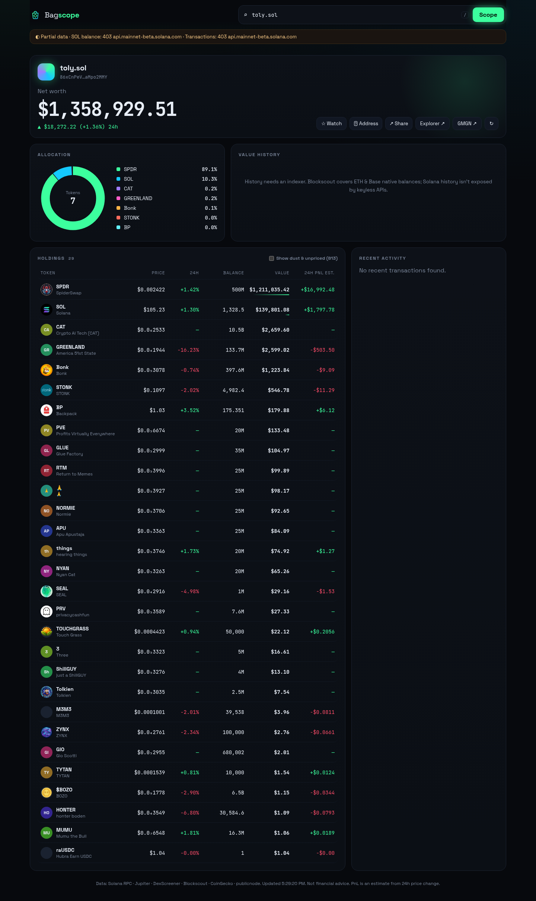
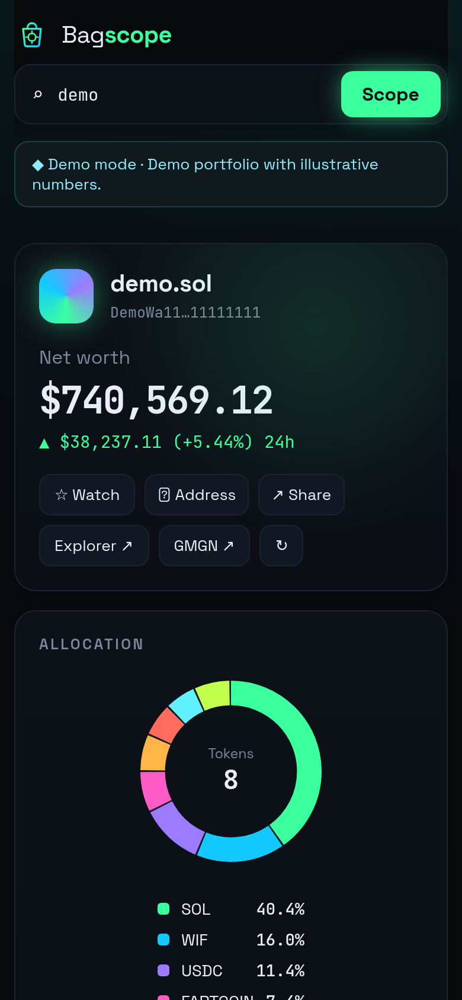
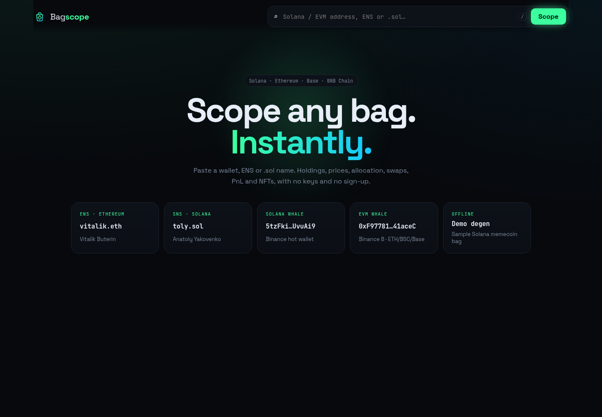
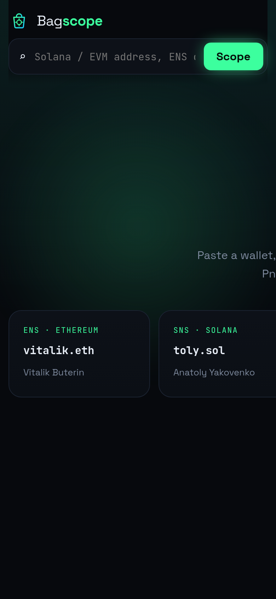

# 🎒 Bagscope

**Scope any bag, instantly.** Paste a Solana or EVM wallet (or an ENS / `.sol` name) to see net worth, holdings with logos and live prices, allocation, value history, recent swaps and an estimated 24h PnL per token. There are no API keys, no sign-up and no backend.

**Live → https://xdi8blox.github.io/bagscope/**  ·  e.g. [vitalik.eth](https://xdi8blox.github.io/bagscope/?address=vitalik.eth) · [toly.sol](https://xdi8blox.github.io/bagscope/?address=toly.sol) · [demo](https://xdi8blox.github.io/bagscope/?address=demo)

## Screenshots

| Desktop | Mobile |
|---|---|
|  |  |
|  |  |
|  |  |

## Features

- **Multi-chain**: Solana, Ethereum, Base and BNB Chain. An EVM address is scanned across all three EVM chains at once, with per-chain filters.
- **Name resolution**: ENS (via viem against a public RPC) and SNS `.sol` names
- **Holdings table**: token logos, price (with degen-style `$0.0₅1234` subscript zeros), 24h change, balance, value with weight bar, and estimated 24h PnL; dust/unpriced tokens hidden by default
- **Allocation donut** (hover to inspect) and **value history** area chart (EVM native balance via Blockscout)
- **Recent activity**: Solana swaps are decoded from pre/post token balances (`12.5 SOL → 1.9M BONK`); EVM method names come from Blockscout
- **NFTs** (EVM, via Blockscout)
- **Watchlist** of multiple wallets with cached totals, a **shareable URL** (`?address=`), copy buttons, and explorer, GMGN and DeBank links
- **Graceful degradation**: if an indexer is rate-limited it falls back to a public RPC plus a Multicall3 check of curated majors and memes, then to the last cached snapshot, then to a labelled demo portfolio
- `/` focuses search; responsive layout for mobile

## Data sources (all keyless and public)

| Need | Source |
|---|---|
| Solana balances, token accounts, transactions | `api.mainnet-beta.solana.com` (fallback: Jupiter Ultra holdings) |
| Solana prices and metadata | Jupiter Price v3, Jupiter Tokens v2 |
| EVM balances, tokens, transactions, NFTs, history | Blockscout v2 (ETH, Base); publicnode RPC + Multicall3 fallback (all chains) |
| EVM token prices and 24h change | Blockscout exchange rates, DexScreener |
| Native prices | CoinGecko public API |
| Names | ENS (viem), SNS (`sdk-proxy.sns.id`) |

No secrets are shipped in the bundle. Public endpoints rate-limit aggressively, so hit ↻ to retry.

## Run

```bash
npm install
npm run dev
npm run build && npm run lint
```

## Tech

Vite · React 18 · TypeScript · viem · hand-rolled SVG charts · GitHub Pages.

## License

MIT © Death (xDi8blox). Not financial advice; PnL figures are estimates.
